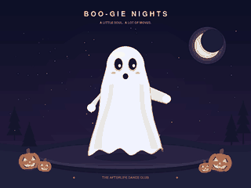

# Python-Animation-
Playing with python animation that is.

# 👻 Boo-gie Nights

A sheet ghost loses its cover, a skeleton steals the dance floor, and the sheet
swoops back down. A 12-second, infinitely looping Halloween short, drawn entirely
in Python with **pygame + Pillow**. No image models, downloaded art, or external
assets. Inspired by and reworked from the supplied sheet-ghost animation.



[Download preview GIF](renders/ghost_dance.gif) · [PNG poster](renders/ghost_poster.png)

The checked-in GIF is a compact **320 × 240, 10 fps** preview with the full
12-second loop. Run the default command below to render the full-quality
**640 × 480, 25 fps** version. `validation.json` records that full-quality render.

## Quick start

Requires Python 3.10 or newer. From this directory:

```sh
python -m venv .venv
# macOS / Linux:
source .venv/bin/activate
# Windows PowerShell: .venv\Scripts\Activate.ps1
python -m pip install -r requirements.txt
python ghost_dance.py
```

The default command writes `ghost_dance.gif`: **640 × 480, 25 fps, 12 seconds**.
Rendering uses a 1920 × 1440 supersampled canvas before Lanczos downsampling.
The GIF has no audio. A 256-color shared palette is learned from 24 evenly
spaced story frames, avoiding per-frame palette changes. Gradients may still show
some banding because GIF is limited to 256 colors.

## Commands

```sh
# Live window (requires a desktop display)
python ghost_dance.py --preview

# Smaller sharing copy
python ghost_dance.py ghost_dance_small.gif --width 480

# Large output with a poster
python ghost_dance.py ghost_dance_large.gif --width 960 --poster poster.png

# Faster draft render
python ghost_dance.py draft.gif --width 480 --fps 10 --supersample 1

# Install as a package, then use the console command
python -m pip install .
ghost-party ghost_dance.gif

# Equivalent module entry point
python -m ghost_party ghost_dance.gif

# Run the deterministic animation checks
python -m unittest discover -s tests -v
```

Preview controls: **Space** pauses, **R** restarts, **Esc/Q** closes the window.
The export path is headless and does not require a display or audio device.
GIF frame rates are deliberately limited to 10, 20, 25, and 50 fps, which map
exactly onto GIF's 10 ms timing units. Higher widths and supersampling increase
render time and memory use. The exporter keeps indexed frames in memory rather
than retaining all full-resolution RGB frames; the default export typically
needs a few hundred MB of available memory.

## Choreography

| Time | Action |
| --- | --- |
| 0–2.4 s | A floating ghost looks around and anticipates the jump. |
| 2.4–3.6 s | The sheet peels upward and arcs toward the left perch. |
| 3.6–9.3 s | The skeleton shuffles, points disco-style, flaps its elbows, and throws jazz hands. Lanterns rain behind it. |
| 9.3–10.6 s | The sheet swoops back while the skeleton eases into its covered stance. |
| 10.6–12 s | The sheet settles with squash-and-stretch and returns to the starting cycle. |

Every frame derives from normalized time. There is no accumulated simulation
state, and the random seed only initializes the star field and lantern layout.
The endpoint is omitted from the export, so there is no duplicated hold frame.
`Scene.image(t)` and `Scene.image(t + 12)` produce the same image.

## Source map

- `ghost_party/scene.py`: primitive drawing, cloth, articulated skeleton,
  choreography, lanterns, and stage composition.
- `ghost_party/export.py`: fixed-palette export, atomic output replacement,
  and full GIF decoding checks.
- `ghost_party/cli.py`: arguments and real-time preview.
- `ghost_dance.py`: convenient standalone entry point.
- `tests/test_animation.py`: deterministic rendering, loop and transition checks,
  invalid CLI dimensions.
- `requirements.txt`: exact versions used for the delivered render.
- `pyproject.toml`: installable package metadata and console entry point.

The embedded pygame font is the only typography dependency. Colors, stage
layout, timings, and poses are ordinary editable Python values. The sheet uses
layered vector shapes, not a physical cloth simulation; bones use an articulated
cartoon rig. The live preview renders as quickly as the host can manage, with a
60 fps clock cap; the GIF always uses the requested fixed frame rate.


---

## 💎 Spectral Skull Vortex (transparent)

A separate deterministic Python renderer spins a supplied skull illustration, shatters its original pixels into crystal shards, releases four screaming spectral ghosts, and reforms the skull through a vortex. It exports every RGBA PNG frame plus a transparent GIF and optional full-alpha APNG.

See [Spectral Skull instructions](README_SPECTRAL.md). **Supply your own original image** via `--source` (the code repository does not include image rights/assets).

```sh
python -m pip install -e .
python -m spectral_skull --source path/to/skull.jpg --output renders/spectral_skull.gif --size 768 --fps 25 --apng renders/spectral_skull.png
```
